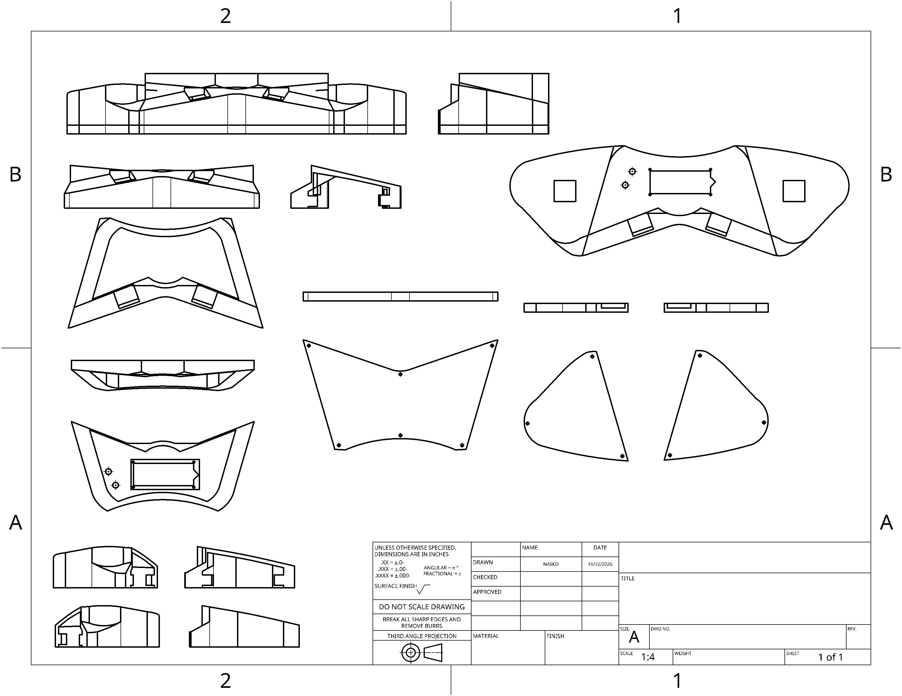
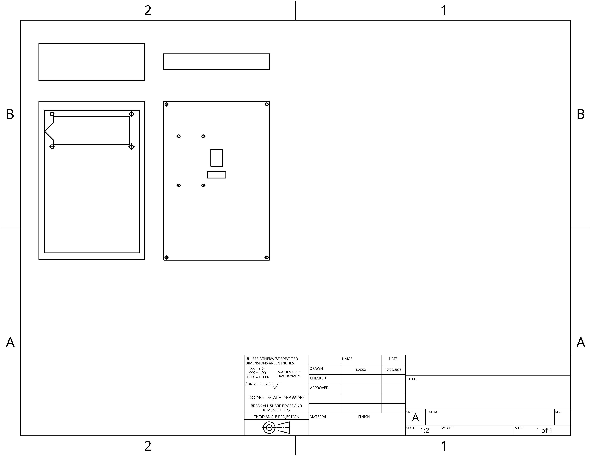

# BufaloTimer

**BufaloTimer** is a portable timer designed to record Rubik's Cube solve durations, or any run that requires hands to be free before and after the solves.
This project is built as part of the [Hackclub Stardance Programme](https://stardance.hackclub.com/projects/39298).

## Features

- **Supports Type-C charging.** — TP4056 modules are placed in both parts for charging. USB Type-C cables that carry 2A can be used with a stable power source (a laptop is recommended).
- **Manual Wiring is Possible.** — All prototyping is made with jumper wires, and nothing more than the materials listed in the BOM is required.
- **Low-Latency ESP-NOW Connection** — The streamer module receives data from the timer using ESP-NOW networking once the MAC addresses of both ESP32s are placed inside the code.
- **Tool for Finding MAC Address** — A code is present in [*grab-mac-addr*](https://github.com/NaskoEquationersson/rubiks-cube-timer/tree/main/grab-mac-addr) folder.
- **Easy Troubleshooting and Modifications** — The chassis is closed with 8 magnets, so if a problem occurs inside, or if you want to change the code, you can open it and do it easily.
- **Display for Streaming Data** — A streamer (often referred to as a "top") component is present in the project that streams the data, so it can be used in competitions to show the solving time.
- **Four Touch Sensors** — Four touch sensors are placed on the main chassis to start and stop recording precisely.
- **Adjustable Time Recording** — Time recording is adjustable via code, and it allows you to change the frequency of saves (although increasing clock speed may create voltage problems).

## Bulk of Materials

|**Name**|**Description**|**Quantity**|
|--------|---------------|------------|
|Filament|PLA+ Filament for 3D Printing (Optional)|1 Roll (1 kilogram)|
|LED|LEDs for Displaying Status|2 pieces, 1 Green and 1 Red|
|Resistor|220Ω Resistors|2 pieces|
|LCD|16x2 LCD Panels to Display Time|2 pieces|
|Magnet|10x5x5 Magnets to Join the Case|8 pieces|
|TTP223|Touch Sensors for Detecting Touch|4 pieces|
|MT3608|Buck Converters to Increase Voltage|2 pieces|
|TP4056|USB-C Charging Module to Charge From a Power Source|2 pieces|
|LiPo Battery|3.7V 500mAh Lithium Polymer Battery to Power the Circuit|2 pieces|
|USB-C Charging Cable|Cables to Charge the Battery|2 pieces|
|Micro USB Data Cable|Cable to Flash ESP32 if It Has a Micro USB Port|2 Pieces|
|On/Off Switch|Switch to Start/Stop the Circuit|2 pieces|
|Push Button|Button to Reset Time|1 piece|
|ESP32|MCUs For the Devices|2 pieces|
|Screws|M3 or Longer Screws to Hold Pieces Together|~16 pieces (10 minimum)|
|Jumper Cables|Cables to Connect All Circuitry|~3 Packs (36+ Cables)|
|Hot Silicone|Silicone to Anchor Pieces|~1 piece|
|Solder Wire|Solder to Join Circuitry|~1 piece|
|Potentiometer|Adjustable 2K Resistors to Set LCD Contrast|2 pieces|
|Breadboard Rail|Power Rail for Distribution of Electricity|2 pieces, 1 breadboard|
|Soldering Flux|Flux to Solder Easily(Optional)|Arbatirary|
|Capacitor|440μF Capacitors to Regulate Voltage|2 pieces|

## Setup Guide

**Note**: Make sure you have ESP-IDF for flashing C code on ESP32s.

### 1. **3D Printing**

- If you are going to use jumper cables, download [*3D Files of Big Chassis*](https://github.com/NaskoEquationersson/rubiks-cube-timer/tree/main/final_models/BigForManualWiring).
- If you are going to use a PCB version (not designed yet), use the smaller version [*3D Files of Small Design*](https://github.com/NaskoEquationersson/rubiks-cube-timer/tree/main/final_models/SmallForPCB).
- Using PLA as filament is recommended.

### 2. ESP Setup

- Flash both ESP32s with the code in [*grab-mac-addr*](https://github.com/NaskoEquationersson/rubiks-cube-timer/tree/main/grab-mac-addr), and note the MAC address of each one.
- Upload both ESP32s with their respective code, and cross-reference their MAC Addresses (put the 1st address in the 2nd code, and the 2nd address in the 1st code).
- Main Chassis must have the code in [*rubiks-code*](https://github.com/NaskoEquationersson/rubiks-cube-timer/tree/main/rubiks-code).
- The Streamer must have the code in [*top-code*](https://github.com/NaskoEquationersson/rubiks-cube-timer/tree/main/top-code).
  
### 3.1. **Circuitry (Manual)**

#### 3.1.1. Main Chassis

- Cut the LiPo battery's cables close to the connection end, and solder those wires with the correct polarity to the TP4056.
- Solder male jumper cables to the output of the TP4056.
- Solder male jumper cables to the output of the MT3608, and female jumper cables to the input of the MT3608.
- Solder a female jumper cable to the + input of the On/Off Switch (middle), and a male jumper cable to the + output of the switch.
- Solder a female and a male jumper cable to both ends of the Push Button.
- Solder a female jumper cable, a 220Ω Resistor, an LED, and a male jumper cable in order, twice.
- Solder 2 male jumper cables and a male jumper cable to the potentiometer.
- Solder male pins on the LCD if not present.
- Set MT3608 to 6V with a multimeter after wiring up the battery and the MT3608.
- Connect everything and the rail according to the table below; adjust jumper types accordingly.
  
|**From**|**To**|
|---------|----------|
|TP4050 + Out|MT3608 + In|
|TP4056 - Out|MT3608 - In|
|MT3608 + Out|On/Off Switch + In|
|MT3608 - Out|Power Rail - Start|
|On/Off Switch + Out|Power Rail + Start|
|Capacitor Legs|One to + One to -|
|Potentiometer 5V|Power Rail +|
|Potentiometer GND|Power Rail -|
|ESP32 5V|Power Rail + End|
|ESP32 GND|Power Rail - End|
|LCD VSS|Power Rail -|
|LCD VDD|Power Rail +|
|LCD V0|Potentiometer Signal In|
|LCD RS|GPIO 19|
|LCD RW|Power Rail -|
|LCD E|GPIO 23|
|LCD D4|GPIO 18|
|LCD D5|GPIO 17|
|LCD D6|GPIO 16|
|LCD D7|GPIO 15|
|LCD A|Power Rail +|
|LCD K|Power Rail -|
|TTP223-1 Sig|GPIO 27|
|TTP223-1 VCC|Power Rail +|
|TTP223-1 GND|Power Rail -|
|TTP223-2 Sig|GPIO 14|
|TTP223-2 VCC|Power Rail +|
|TTP223-2 GND|Power Rail -|
|TTP223-3 Sig|GPIO 34|
|TTP223-3 VCC|Power Rail +|
|TTP223-3 GND|Power Rail -|
|TTP223-4 Sig|GPIO 13|
|TTP223-4 VCC|Power Rail +|
|TTP223-4 GND|Power Rail -|
|Green LED + Anode|GPIO 25|
|Green LED - Cathode|Resistor-1|
|Resistor-1|Power Rail -|
|Red LED + Anode|GPIO 32|
|Red LED - Cathode|Resistor-2|
|Resistor-2|Power Rail -|
|Push Button In|GPIO 26|
|Push Button Out|Power Rail -|

#### 3.1.2. Streamer Chassis

- Cut the LiPo battery's cables close to the connection end, and solder those wires with the correct polarity to the TP4056.
- Solder male jumper cables to the output of the TP4056.
- Solder male jumper cables to the output of the MT3608, and female jumper cables to the input of the MT3608.
- Solder a female jumper cable to the + input of the On/Off Switch (middle), and a male jumper cable to the + output of the switch.
- Solder 2 male jumper cables and a male jumper cable to the potentiometer.
- Solder male pins on the LCD if not present.
- Set MT3608 to 6V with a multimeter after wiring up the battery and the MT3608.
- Connect everything and the rail according to the table below; adjust jumper types accordingly.

|**From**|**To**|
|---------|----------|
|TP4050 + Out|MT3608 + In|
|TP4056 - Out|MT3608 - In|
|MT3608 + Out|On/Off Switch + In|
|MT3608 - Out|Power Rail - Start|
|On/Off Switch + Out|Power Rail + Start|
|Potentiometer 5V|Power Rail +|
|Potentiometer GND|Power Rail -|
|ESP32 5V|Power Rail + End|
|ESP32 GND|Power Rail - End|
|LCD VSS|Power Rail -|
|LCD VDD|Power Rail +|
|LCD V0|Potentiometer Signal In|
|LCD RS|GPIO 19|
|LCD RW|Power Rail -|
|LCD E|GPIO 23|
|LCD D4|GPIO 18|
|LCD D5|GPIO 17|
|LCD D6|GPIO 16|
|LCD D7|GPIO 15|
|LCD A|Power Rail +|
|LCD K|Power Rail -|

### 3.2. **Circuitry (PCB)**

- Solder all the parts into their places described in the PCB files.
- Make sure to plug in the battery.

### 4.**Fit Inside the Chassis**

- Use hot silicone to anchor pieces.
- *Silicone magnets on the centre piece first*, and then use those as a reference to determine the polarity of the right-hand and left-hand parts.
- Disconnect and anchor switches, buttons, and charging modules first, and then reconnect them to their respective parts.
- Anchor LCDs inside, and anchor them before pulling all the circuitry inside.
- Make sure you get all of the parts working inside before tightening the screws.
- Do not forget to level all of your screws if they are longer than the chassis.
- It is not recommended, but it is possible to use hot silicone to seal the Streamer from its sides.

## Troubleshooting

- **Screen Has One Row of White Boxes**: Make sure the wiring of the LCD and ESP32 is correct (it is almost always not when wiring for the first time), and check if a value above 5V is present between GND and 5V of the ESP32.
- **ESP32 Flashes Fast and Doesn't Open**: Use ``idf.py monitor`` to check for SPI errors, and if you find one, make sure the ESP32 is wired correctly; no pins between GPIO 6 and 12 are wired, and the ESP32 receives enough voltage as described above.

## 3D Models

All 3D model outputs are placed in [*final-models folder*](https://github.com/NaskoEquationersson/rubiks-cube-timer/tree/main/final_models), and all models used for scale are provided in
[*models-used-for-scale folder*](https://github.com/NaskoEquationersson/rubiks-cube-timer/tree/main/models_used_for_scale).
Reference Sheets of the 3D design are also provided in the *final-models folder*, and two of them are displayed below:

## AI Usage

All of the C code present in the files is AI-generated. There are some slight modifications to them, but mainly their base is made of AI output.
AI-generated files are generally `main.c` files, and other files are generated by ESP-IDF automatically.
None of the 3D designs are made with AI, and all imported designs are in [*models-used-for-scale folder*](https://github.com/NaskoEquationersson/rubiks-cube-timer/tree/main/models_used_for_scale).

## A Quick Note for Reviewers

Hello! I am @Nasko. I am leaving this message because I noticed that the system only redeems hours I logged in this app, and not the ones that I logged in Stasis. I had 28 hours previously on this project, but Stasis closed before I could renew my design. So, I don't know if you can add those hours to this project too, or if it's in policy to do this, but I appreciate your help if you do contact me on this matter. Thanks in advance.
